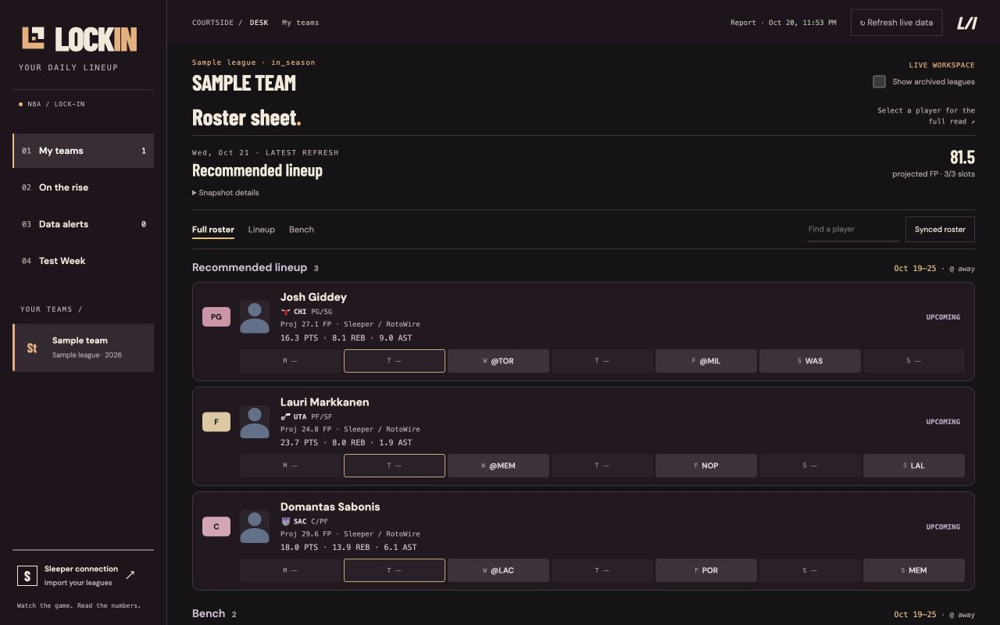
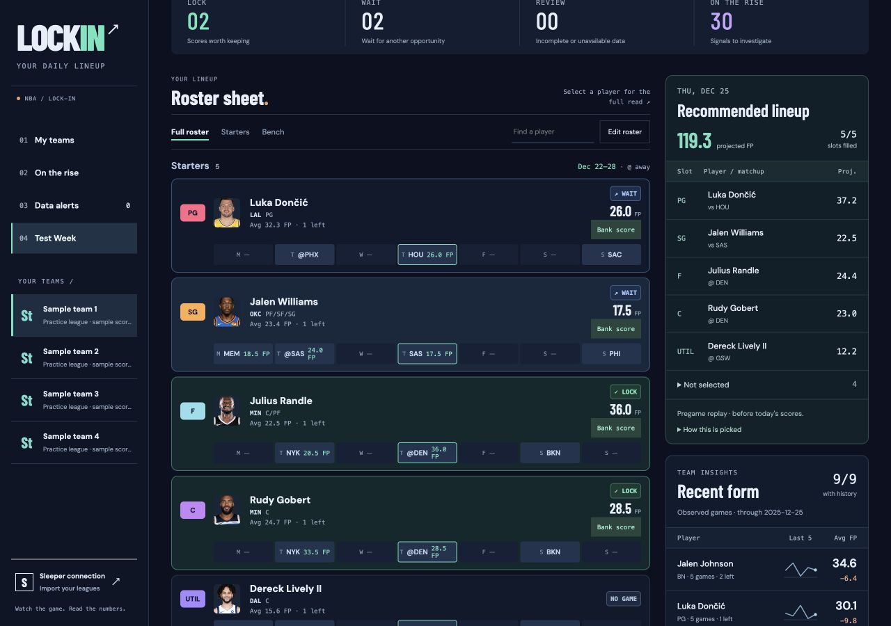
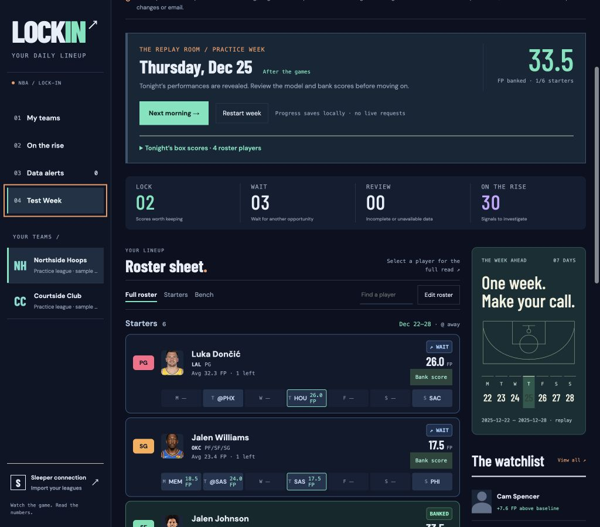
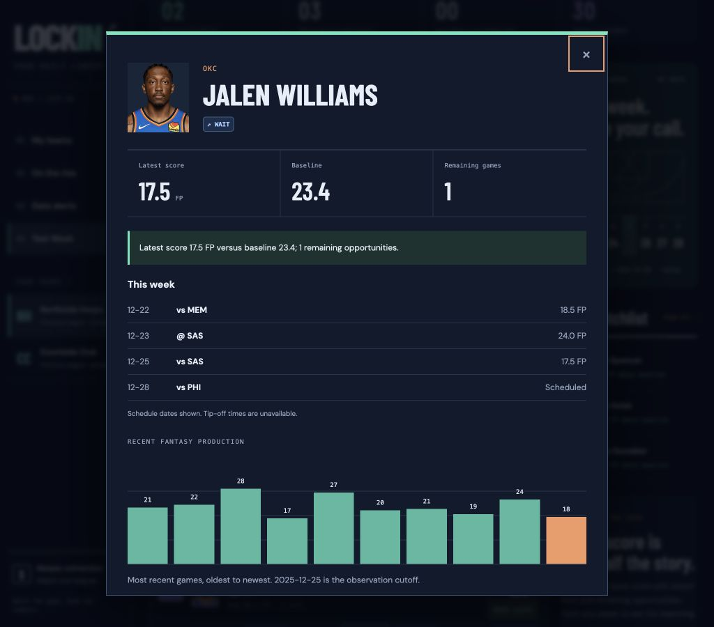
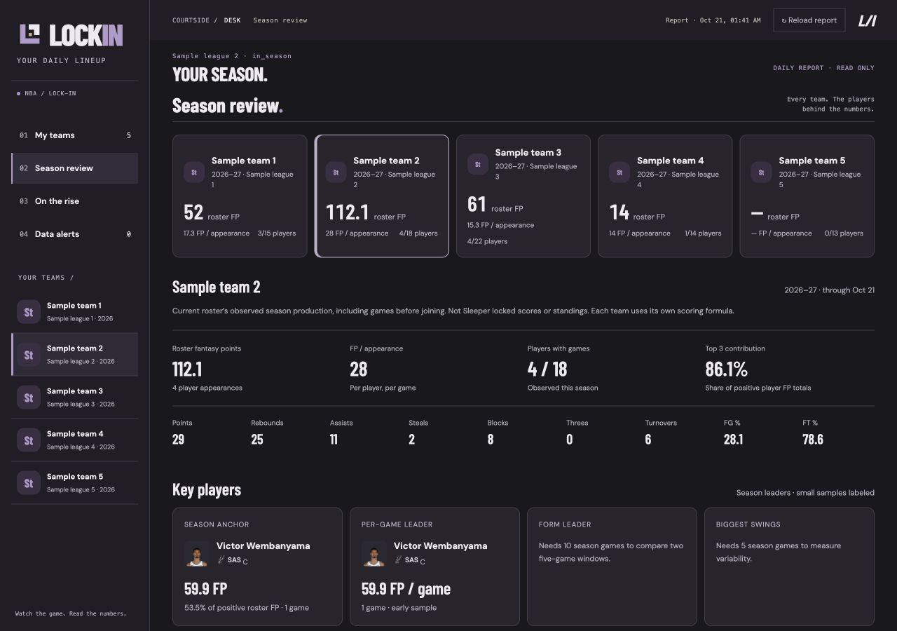
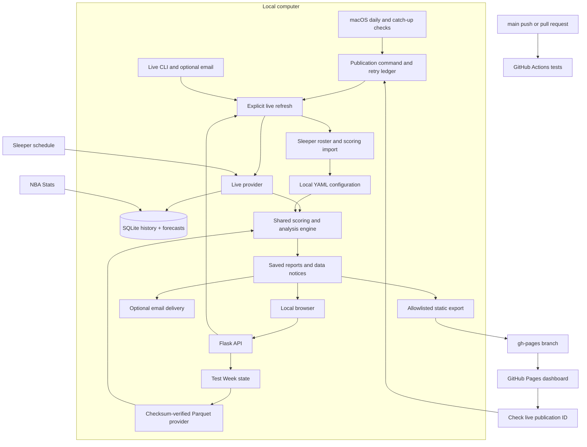
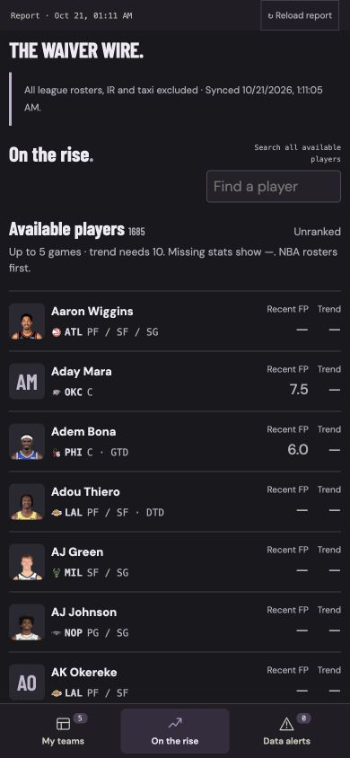

# LockIn

**An NBA fantasy basketball dashboard that helps managers decide whether to keep a completed score or wait for another game.** LockIn combines league-specific scoring, recent player performance, remaining opportunities, daily positional lineups, and waiver research in one interface, with an offline practice week for exploring decisions.

Python · Flask · SQLite · pandas · NumPy · vanilla JavaScript · pytest · macOS launchd · GitHub Pages / Actions

One local SQLite database retains live game history and separate pregame forecasts for every league. A daily Mac job refreshes that history, computes league-specific reports, and publishes static files to GitHub Pages. The website needs no database or application server; historical practice uses separate, checksum-verified fixtures.

**[Open the daily dashboard](https://mkodithuwakku.github.io/LockInModel/)** — a public, read-only report published from the local Mac around 7:00 AM America/Edmonton, with catch-up after wake. Browse teams, player details, and league-specific pickup signals from any device. [Hosting and refresh details](docs/HOSTING.md).

## Screenshots and demo



*Current roster-first layout, using an illustrative five-player, three-slot league with stored Sleeper / RotoWire forecasts. Bench, injured, and off-day players retain per-game estimates. See the [phone layout](docs/screenshots/roster-first-mobile.png) and open a player for the [complete projected box score](docs/screenshots/player-projections-mobile.png) (earlier palette). Approved scoring adjustments are available under Scoring method, not counted as Data alerts.*


The interface uses a compact fantasy lineup layout: charcoal surfaces with a subtle plum undertone, soft off-white text, muted purple accents, small soft-gold details, colored position slots, small portraits, NBA logos beside team abbreviations in roster rows and expanded individual player cards, injury labels, and a seven-day opponent strip for every player. Each upcoming game tile shows **Proj FP** using that player’s saved per-game baseline; completed games show **Final FP** when observed. Estimates are league-scored and are not opponent-adjusted. Expanded player cards use a larger NBA logo and abbreviation with a restrained team-colour header. Completed fantasy-point totals, history bars, and weekly roster scores share green/amber/red comparisons against each player’s saved recent baseline (including prior-season blending) or stored-history average. Near-average means ±10%, with a 2 FP minimum band; projections stay neutral and colours do not override model lock calls. See [performance colours](docs/PERFORMANCE_COLOURS.md). A custom interlocking LI emblem anchors the wordmark and favicon. Team selection uses each league’s custom Sleeper photo, then the owner’s profile photo, with initials if neither loads. The live roster sheet places the latest refresh’s recommended starters in their optimized position slots, followed by bench and reserves. Each card retains its forecasts, lock/wait indicators, and completed fantasy points. **Recommended lineup** assigns eligible players to each league’s slots to maximize that day’s projected FP. The full-width **Roster sheet** is the primary interface on every screen, immediately after compact team context and controls. Summary counters and explanatory context sit below the full roster, with no large hero or decorative header above the players. The date, projected total, and snapshot details sit inside the sheet; **Recent form** stays below it. Recent form shows individual five-game averages, sparklines, changes versus the previous five games, and remaining opportunities. The earlier lineup/form captures below show the previous navy palette and historical/sample data, not current NBA recommendations.

**Daily details:** tiny previous-night badges mark NBA-wide top-three performances in threes, made baskets, rebounds, missed shots, steals, blocks, minutes, assists, turnovers, made free throws, and missed threes, combined steals/blocks, low-turnover creation, double-doubles (☕), and triple-doubles. League-scored badges add highest/lowest fantasy points per minute and the largest positive/negative differences from saved pregame forecasts. Ties qualify; three icons stay visible beside a name, with the full breakdown on tap. These are fun annotations and never change fantasy scores or recommendations. Projection comparisons start once pregame forecasts have been archived in the existing local database; missing forecasts are not reconstructed after results. A discrete **Badge guide** opens outside the main navigation and explains all **44 indicators**. Single-game tiers cover made threes, assists, rebounds, blocks, steals and scoring; new awards cover the three lowest assist-minus-turnover totals, three-game above/below-season-average streaks, and league-scored leaders in wins/losses, at home/away, and ages 32+ or 23 and younger. Milestones show the highest tier per stat; contextual leaders include ties for first. Streaks require at least four current-season games and a game last night; unknown birthdays/results cannot create awards. Existing schedule and player metadata supply context, and confirmed win/loss is retained in the local game store. See the [badge rules and guide previews](docs/DAILY_BADGES.md).



*The daily plan shows positions, opponents, projected FP, and an expandable list of excluded players. The five highest recent averages appear first; expand to see the full team or select a player for details. On [mobile](docs/screenshots/daily-lineup-mobile.png), this older capture puts the panel above the roster; the current layout integrates the recommended lineup into the roster sheet and keeps Recent form below it. Sparse history shows its actual sample size; unavailable values remain dashes. Form is an observed average, separate from the model's weighted baseline.*



*Test Week reveals one night's results at a time. Scores can be banked for starters and retained as the week advances. Expand “Tonight’s box scores” for the nightly breakdown. This older capture includes the retired decorative court; the current roster-first layout appears above.*



*Player details connect a recommendation to the observed performance and remaining opportunities.*

[View the mobile roster](docs/screenshots/mobile-roster.png) and [phone player details](docs/screenshots/mobile-player-detail.png). At 740px and below, the dashboard uses fixed bottom navigation, a swipeable team selector, and compact roster rows with lineup slots, team labels, weekly games, and recommendation indicators. About seven complete rows fit in the tested 390px roster viewport after scrolling past the header. Profiles open in a bottom sheet. The same URL adapts automatically; no app installation or separate mobile site is needed. Keyboard focus indicators, a skip link, reduced-motion styles, and safe-area spacing support navigation.

*The older mobile roster/player captures show generic historical sample teams. The new daily-lineup captures use an isolated local Test Week. None demonstrate current NBA recommendations or live scoring notices; see [screenshot scope](docs/screenshots/README.md).*

To try the workflow, follow [setup](#running-locally), select **Test Week**, reveal games, open a player, and bank an eligible score. Progress saves locally. The hosted dashboard publishes live snapshots; Test Week and roster editing remain local.

A drafted league can be active before NBA opening night. The live provider checks the season schedule first and displays **UPCOMING** with opening-week opponents until completed games are available. A later statistics outage preserves roster and schedule data; a schedule outage preserves available box scores but withholds lock decisions.



*The separate Season review tab uses full stored season history. This early-season example has only one night of observations; longer trends remain blank. [Phone view](docs/screenshots/season-review-mobile.png).*

## Problem and scope

A strong fantasy performance needs context: how unusual was it for this player, how many chances remain this week, and how does this league score the box score? Managing multiple teams also means tracking different rules and deciding whether a rising player would improve a particular roster.

LockIn brings those checks into one personal workspace. A manager imports Sleeper teams or uses sample rosters, reviews scores and explanations, and makes the actual league decisions in Sleeper. The repository implements the dashboard, Flask API, analysis engine, data adapters, local persistence, historical capture, practice simulator, report delivery, and tests. Sleeper supplies league data, player metadata, and the season schedule. Observed performances come from NBA Stats, with validated Sleeper / Sportradar final box scores when NBA Stats is unavailable or missing recent finals.

The app does not submit locks, waivers, or lineup changes to Sleeper. Its lock and pickup scores are **explainable heuristics, not calibrated predictions or a proven optimal policy**.

## Key features

- **Multi-team analysis:** separate league scoring, starters/bench filters, player histories, and saved archives for older Sleeper seasons.
- **Projections for the full roster:** per-game FP and PTS/REB/AST on every roster row, with a complete projected box score in player details. Current-season Sleeper / RotoWire forecasts cover players without usable current game history, including rookies; bench/off-day/injured players retain their baseline. [Projection sources and bonus estimates](docs/PROJECTIONS.md).
- **Daily recommended lineup:** exact maximum-weight assignment across each league’s PG/SG/SF/PF/C, G/F, and repeated UTIL slots, using scheduled roster players and pregame league-scored projections. When slots stay unfilled — off days or games already underway — healthy benched players hold them as marked zero-projection placeholders so the sheet is never blank; injured and reserve players never fill. Shows exclusion reasons; no Sleeper changes are submitted.
- **Locked-player pinning:** tap a lock icon on any Sleeper starter’s roster row to flag a locked-in player. The optimizer pins that player into its synced Sleeper slot and treats the flagged score as banked rather than projected; remaining slots re-optimize normally, both server-side and immediately in the browser. Flags persist to `state/locks.json` — locally through the Flask app, or from the published phone site through a small serverless bridge — and expire with each new matchup week. A pinned player stays in the sheet even without a game that day, keeping any banked score. The published site also reads the committed lock document back through the same serverless endpoint, so flags made on one device appear on others before the next daily publish. Flags are user-supplied and not verified against Sleeper, which exposes no lock field in its API. [Specification](docs/epics/LOCKED_PLAYER_PINNING.md).
- **Season review:** a separate all-team dashboard with season totals, box-score production, weekly FP per appearance, full-roster contributors, and key players. Uses each league’s formula and labels current-roster scope and small samples. Its **Badge race** tracks season leaders for all 44 badges, total awards, negative indicators, milestones, and badge variety, in a dedicated tab with NBA-wide and My roster views. Every badge-race player opens a card, including players outside your roster; leaderboard and highlight cards include player portraits. Player cards show compact season totals for total awards, chaos, milestones, and variety as earned-of-44 types, with an expandable earned-badge list and repeat counts. Click or tap outside a player card to close it, even after scrolling. Awards accumulate in the existing SQLite database without duplicate refresh counts. [Metrics and boundaries](docs/SEASON_REVIEW.md).
- **Compact team insights:** ranked five-game form, per-player sparklines tinted in NBA team colours, change versus the previous five games, and expandable full-team coverage on desktop and phones.
- **Daily player badges:** tiny previous-night NBA-wide indicators, including league-scored projection surprises and FP/min, plus 📈 combined defense, 🧠 low-turnover creation, ☕ double-doubles, and 🎩 triple-doubles. [Rules and forecast archive](docs/DAILY_BADGES.md).
- **Lock/wait explanations:** compare the latest eligible score with a weighted baseline and verified remaining opportunities; missing inputs produce explicit review states.
- **On the Rise:** compare five recent games with an earlier baseline, discount fragile improvement signals, and estimate fit against compatible roster players. A schedule-aware add/drop card in the roster sheet weighs this week plus roughly next week's games before suggesting a swap, and advises holding when the long-run math is negative.
- **Games to watch:** today's matchups ranked by how many of your rostered players are involved, across every loaded team. A player rostered on multiple teams counts once and shows each team that owns them. Rows carry a muted NBA team-colour accent. Derived entirely from the published schedule data; tip-off times are unavailable.
- **Badge race tab:** season-long badge leaderboards in their own view, defaulting to the NBA-wide pool with a My roster toggle.
- **Offline Test Week:** reveal nights, bank one score per starter, edit practice rosters, and resume progress without changing live teams.
- **Read-only Sleeper import:** fetch leagues, scoring, and league-wide ownership from a username; preserve the previous team configuration if an import fails.
- **Shared live history:** SQLite accumulates observations across daily refreshes, updates corrected games without duplicates, and shares each refresh across every league. An explicit refresh rechecks completed games even after an earlier refresh that day.
- **Daily web publication:** the Mac refreshes data and pushes an allowlisted static export; GitHub Pages serves it. Wake/login catch-up, bounded retries, and deployment confirmation handle interrupted runs. Failed data refreshes and expired reports suppress recommendations.
- **Extensible league formulas:** configurable milestone bonuses, omitted unavailable fouls, and a disclosed total-rebound fallback support leagues without hardcoding team-specific rules.
- **Local reporting:** save reports before optional email delivery, suppress repeated daily delivery attempts, and deduplicate pickup alerts.

## Tech stack

| Layer | Implementation |
| --- | --- |
| Interface | HTML, CSS, vanilla JavaScript; browser fetch, dialogs, and localStorage for the selected team; no frontend build step |
| Backend | Python and Flask, with one background worker for sync/refresh jobs |
| Analysis | pandas and NumPy for normalization, weighted statistics, and candidate screening |
| Persistence | SQLite history + forecasts, PyYAML configuration, JSON snapshots/ledgers, Parquet replay fixtures; no database server |
| Integrations | nba_api endpoint definitions, Requests, Sleeper league/player/schedule feeds, archived NBA tables, Gmail SMTP over TLS |
| Configuration | python-dotenv, checked-in sample YAML, ignored local overrides |
| Verification | pytest, Black, Node frontend policy tests; GitHub Actions runs checks on source pushes and pull requests with Python 3.11 and 3.12 |
| Scheduling | macOS LaunchAgent for daily website publication, backed by a local completion/retry ledger |
| Runtime | Local Flask on 127.0.0.1:8765 for interactive practice; GitHub Pages for public read-only reports, published from the Mac to a dedicated static branch |

Exact direct dependency versions are in [requirements.txt](requirements.txt) and [requirements-dev.txt](requirements-dev.txt).

## How the system works



1. The local browser bootstraps its session and reads saved reports through Flask. The hosted browser reads static `report.json`. Opening either dashboard does not implicitly fetch NBA statistics.
2. An explicit local refresh or due publication imports Sleeper settings and uses the live provider. SQLite starts with a full-season download, then daily updates with a seven-day overlap and weekly full reconciliation. Test Week instead reads immutable fixture tables; both providers feed `engine.build_dashboard()`.
3. The engine excludes future observations, resolves identities, applies each league's weights and bonuses, and runs lock analysis and pickup screening. Approved foul/rebound fallbacks produce information notes; unknown nonzero rules still suppress actionable recommendations. Missing schedules remain unknown rather than becoming zero remaining games.
4. The publisher first fast-forwards `main` to pick up phone-written lock commits, then exports only public display fields and website assets, pushes them to `gh-pages`, and checks the live publication ID before marking the daily slot successful. Failed or partial runs retain retry state. GitHub Actions checks source changes; it no longer fetches daily data.
5. Both dashboards retain the original generation timestamp and suppress stale actions after 26 hours, with a two-hour allowance beyond the daily interval. Crossing into the next Monday expires the previous week's report even sooner. The CLI can separately save and email the shared analysis.

## Architecture and data model

| Files | Responsibility |
| --- | --- |
| [season_review.py](season_review.py) | Full-season team/player production, weekly summaries, and honest sample coverage |
| [daily_badges.py](daily_badges.py), [badge_awards.py](badge_awards.py) | NBA-wide stat and league-scored badges, single-game milestones, contextual awards, and tie handling |
| [app.py](app.py), [web/](web/) | HTTP boundary, jobs, interface state, rendering, and user actions; [insights.js](web/insights.js) derives observed team form |
| [engine.py](engine.py), [providers.py](providers.py), [schedule.py](schedule.py) | Shared orchestration, live/replay policies, and cached weekly schedule |
| [fetch_data.py](fetch_data.py), [scoring.py](scoring.py) | Identity/date normalization, box-score validation, bonus flags, fantasy points |
| [decide.py](decide.py), [model.py](model.py), [season_history.py](season_history.py), [pickups.py](pickups.py) | Weekly decisions, statistical heuristics, sparse-history blending, rising-player screening |
| [simulation.py](simulation.py), [storage.py](storage.py) | Practice transitions, config validation, atomic file replacement, weekly lock-flag persistence |
| [lineup.py](lineup.py), [projections.py](projections.py) | History-based and validated Sleeper forecasts, projected box scores, exact positional assignment, and locked-slot pinning |
| [game_store.py](game_store.py), [forecast_store.py](forecast_store.py), [badge_store.py](badge_store.py) | SQLite observations, incremental upserts, pregame forecast snapshots, and season badge awards |
| [sleeper.py](sleeper.py), [sleeper_stats.py](sleeper_stats.py), [transport.py](transport.py), [capture.py](capture.py) | League import, fallback box-score reconciliation, cached/paced requests, historical capture |
| [pages.py](pages.py), [publication.py](publication.py), [web/pages.js](web/pages.js) | Allowlisted export, local daily publication, wake catch-up, browser expiry, remote lock sync |
| [api/lock.mts](api/lock.mts), [shared/locks-core.mjs](shared/locks-core.mjs) | Optional serverless write bridge that commits phone lock toggles to `state/locks.json` on `main` via the GitHub API |
| [main.py](main.py), [notify.py](notify.py) | Reports, delivery ledger, pickup cooldowns, SMTP |
| [tests/](tests/), [docs/](docs/) | Regression checks and implementation guides |

The main entities are **teams**, **player-game observations**, **practice runs**, and **reports**. A team contains a stable ID, roster names, a starter subset, full imported `roster_positions` (including empty and repeated slots), and optional league weights and ownership metadata. Imported teams use `sleeper-<league_id>` IDs. SQLite stores observations under a composite season/game/player key and records successful refresh metadata per season. A separate forecast table retains pregame estimates by scoring formula, date, and player for next-day badge comparisons. Season badge tables retain one award per formula, night, player, and badge; fingerprints skip unchanged nights and invalidate later streaks when earlier observations change. Raw box scores can be rescored for different leagues; derived bonus indicators are recomputed when scoring. The engine maps roster names to NBA identities. Configuration and reports remain separate files, without cross-file foreign-key constraints.

| Local path | Stored data |
| --- | --- |
| `config.local.yaml` | Authoritative personal configuration; falls back to `config.yaml` when absent |
| `data/fixtures/2025-26/` | Game, schedule, and prior-season Parquet tables plus checksums |
| `data/lockin.sqlite3` | Permanent live player-game history and successful refresh timestamps |
| `state/publication.json` | Published commit, daily completion, pending deployment, and retry state |
| `data/cache/` | Archived downloads, HTTP responses/cooldowns, optional cached portraits |
| `state/test-week.json` | Practice configuration snapshot, date/phase, revision, banked scores |
| `state/` | Reports, Sleeper player metadata, email attempts, pickup alert history |

These generated/personal paths are ignored by Git. The shareable [fixture manifest](data/fixture-manifest.json) records provenance and counts.

### API and local security boundary

| Route | Purpose |
| --- | --- |
| `GET /api/bootstrap` | Session token and initial metadata |
| `GET /api/dashboard` | Saved live workspace or date-selected replay |
| `GET/POST /api/test-week` | Read practice state or advance, bank, edit, and reset |
| `POST /api/roster` | Persist local roster edits; imported rosters are managed in Sleeper |
| `POST /api/sync`, `POST /api/refresh` | Start background import/analysis; return a job ID |
| `GET /api/jobs/<id>` | Poll completion or failure |

The server binds to loopback, restricts trusted hosts, rejects requests marked cross-site, and requires JSON plus a session CSRF token for mutations. These protections support the local app. The hosted Pages site has no Flask API or login: its reports are public, its controls are read-only, and its artifact excludes personal configuration and credentials. Credentials stay in an ignored `.env` file.

## Engineering decisions and tradeoffs

The rationale below describes how each choice fits the implementation, rather than claiming an undocumented development history.

| Decision | Why it fits | Tradeoff | Alternative |
| --- | --- | --- | --- |
| One engine with live and fixture providers | Dashboard, CLI, and practice share scoring; fixture tests avoid provider availability | Historical schedule and prior policies differ from live inputs | Versioned provider contracts with timestamped historical snapshots |
| SQLite for observations; atomic YAML/JSON for configuration and reports | Games accumulate without duplicate rows; corrected box scores update in transactions | Old corrections require reconciliation; configuration remains a separate file | A database for every entity if multi-user editing becomes necessary |
| Local analysis with static publication | One authoritative game database; the website needs no database or runtime server | The Mac must be awake and online to publish; wake catch-up cannot restore a missed decision deadline | Hosted execution if unattended uptime becomes a requirement |
| Vanilla JS and Flask | Small deployment surface and no frontend build pipeline | UI state, rendering, and events concentrate in one script | Split frontend modules or a component framework as complexity grows |
| Explicit unavailable states | Provider failure cannot safely mean there are no remaining games | Required missing inputs prevent recommendations | Separately labeled fallback with evidence about its reliability |
| Record email attempt before SMTP | An ambiguous timeout does not trigger automatic duplicate sends | Failure can suppress a report that was never delivered | Durable outbox and a delivery service supporting idempotency keys |

## Technical challenges

**Keeping replay honest.** Morning practice uses observations through the previous day; night replay includes the selected day. Live reports include same-day performances only after the schedule confirms the game is final. Future rows are excluded from model and pickup inputs. Tests change future scores and confirm present results stay unchanged. Finalized schedules and current/sample ownership still limit realism. The lesson is to distinguish time-safe statistical inputs from a fully realistic backtest.

**Normalizing different scoring rules.** Core stats must be finite and nonnegative. Missing required weighted fields are rejected. Milestone bonuses are derived from each game, including 15+ assists and 20+ rebounds; positive thresholds for points, rebounds, assists, steals, and blocks are configurable. Double/triple-double and threshold bonuses stack. Unavailable fouls are omitted, and unavailable rebound splits use a disclosed total-rebound approximation. Unknown nonzero rules still create scoring gaps. Missing, zero, and intentionally ignored must remain different data states.

**Handling unreliable external requests.** `CachedHTTP` combines persistent caches, host pacing, connect/read timeouts, and cooldowns. A filesystem lock serializes requests across processes; rate limits honor `Retry-After`. Imports build all team records before replacing configuration, although the player-directory cache can update earlier. This favors coherent team snapshots over partial progress, at the cost of serialized throughput.

**Separating data durability from website delivery.** A successful database refresh and a successful deployment are different events. SQLite commits game upserts and refresh metadata together; failed downloads preserve existing history. The publisher separately tracks the uploaded commit and publication ID, then confirms the public report before recording daily completion. A later run can confirm a pending deployment without repeating the data fetch. Static serving stays available while the Mac sleeps, but freshness still depends on local execution. [Architecture](docs/ARCHITECTURE.md) and [Hosting](docs/HOSTING.md) describe these boundaries and recovery paths.

**Protecting practice decisions from stale tabs.** Mutations require the current revision. An in-process lock protects read/check/write, and successful mutations generate a new revision. Banked players cannot be removed or toggled, roster edits happen only in the morning, and the week cannot advance past Sunday night. This prevents stale-tab overwrites within the intended single-server workflow; it is not a cross-process transaction system.

## Deep dive: from a box score to LOCK or WAIT

For a selected player, `per_player_week_decision()` in [decide.py](decide.py) follows this path:

1. Normalize observed logs, apply league weights, and select the latest completed game in the Monday–Sunday week. No eligible game yields `NO_GAME`; no history yields `NO_HISTORY`.
2. Build a baseline from the configured recent window (defaults: 14 days, at most 10 games, with older history as a fallback). `rolling_baseline()` weights games exponentially, blends the mean with an available prior, and applies variance floors for sparse samples. Before a player has 10 current-season games, saved prior-season games fill the window instead of applying a second mean-shrinkage prior. The current game participates in the performance baseline but is excluded from rarity comparisons.
3. Obtain a verified remaining-game count. An unavailable schedule yields `SCHEDULE_UNAVAILABLE` and `decision: null`; a verified zero is a valid model input.
4. Estimate the chance that at least one future performance exceeds the current score:

   ```text
   p_future_beats = 1 - Φ((current_fp - mean) / standard_deviation)^remaining_games
   ```

   This assumes independent future scores from the same Normal distribution. For sparse current-season histories, saved previous-season games supply real observations for the baseline and rarity comparison. After that bootstrap, replay uses a prior-season game average and the live provider uses season observations older than 14 days as its shrinkage prior. No additional career requests are made.

5. Start the lock score at `1 - p_future_beats`, then apply rarity, small-sample, remaining-opportunity, and optional conservative-mode adjustments. Clamp to `[0, 1]`; scores at least `0.5` become `LOCK`. Those adjustments make the final value a heuristic preference, not a calibrated probability.
6. Return the score, baseline, opportunities, history, and explanation. The engine withholds actionable output when league scoring is incomplete. The user acts in Sleeper, or banks the score locally in Test Week.

**On the rise** also lists unrostered players from the complete league ownership snapshot, including reserves and taxi exclusions. Search covers the entire available pool; rows load in batches of 30, with NBA-assigned players first. Unranked players show their observed mean from up to five games when available and dashes for missing analysis, without becoming pickup recommendations. Compact 40px portraits show the full headshot on desktop and mobile. The dated directory remains visible if recommendations expire.



Pickup analysis is separate: it needs at least 13 observations, compares the last five games with up to 20 earlier games, checks minutes and consistency, discounts shooting/steals/blocks spikes, and prefers a compatible bench replacement. It does not optimize every roster slot or model injuries.

## Deep dive: the daily lineup

The engine scores history strictly **before the selected day**, then uses the configured recency-weighted baseline to project one game per eligible roster player. With fewer than 10 current-season games, projections and lock baselines fill the configured game window with the latest available previous-season games. One current game plus nine prior games gradually becomes ten current games, weighted toward newer performances. This also applies to players returning from injury midseason. Once the window is filled by current-season games, the normal current-season model takes over. Without usable current observations, projections fall back to current-season Sleeper / RotoWire forecasts, then locally saved historical baselines. The [player details](docs/screenshots/season-blend-mobile.png) show the actual current/prior game counts. Every roster player receives a forecast independently of daily start eligibility. Sources and dates are labeled; missing inputs never become invented zero-point forecasts. Expected milestone bonuses use supplied frequencies or an explicit Poisson approximation, rather than thresholding an average stat line.

`lineup.py` solves a maximum-weight assignment with the Hungarian algorithm. A flexible 50-FP PG/SG goes into SG when that frees PG for a 49-FP PG-only player, instead of greedily blocking that player. Every active league slot is represented, including duplicate UTIL slots and currently empty starters; players appear at most once. Zero-point vacancies let the optimal plan decline a negative-contribution start rather than being forced into one. When too few same-day eligible players exist to cover the slots — off days or players already underway — the sheet fills leftovers with healthy benched players as marked zero-projection placeholders, so the bench is never full and the sheet never empty. Runtime is `O(slots² × (players + slots))`, with no extra dependency or hardcoded league shape.

Live candidates need a verified game that day and a pre-game schedule status to score in the plan. Reserve/taxi and confirmed-out players are excluded. Questionable players remain eligible and are labeled; their projections are not injury-adjusted. Off-day placeholders and locked players pinned without a game occupy slots without adding projected points. Unknown slots withhold the plan until supported, and missing schedules/projections produce an explicitly partial plan. This is a **daily pregame snapshot**, not weekly lock optimization: existing Sleeper lock selections and exact tipoff deadlines are not imported. Check them in Sleeper before acting. The dated lineup stays visible until replaced by the next refresh, including across midnight or a failed refresh; older reports remain labeled as saved/outdated. Add or drop players in Sleeper, then refresh and publish from the Mac to rebuild the sheet. Test Week retains its editable starter selection and separate pregame preview. [Formula and boundaries](docs/MODEL.md#11-daily-lineup-projections-and-assignment).

## Running locally

Use macOS or Linux (or a compatible environment such as WSL): the HTTP and email locks use Unix `fcntl`. CI targets Python 3.11/3.12; the existing local environment runs Python 3.9.6. Run commands from the directory containing this README.

```bash
python3 -m venv .venv
source .venv/bin/activate
python -m pip install -r requirements-dev.txt
python capture.py
python app.py
```

Open [localhost:8765](http://127.0.0.1:8765), then select **Test Week** for the offline demo. `python gui_select.py` also starts the server and opens a browser. No database setup, Node installation, or email credentials are needed for practice.

The first capture needs internet access. It resolves the archive's current revision, records it locally, and reuses that revision/downloads on later runs. A fresh checkout can therefore capture a different revision from the committed manifest. Capture does not call NBA Stats or download portraits; missing portraits use a placeholder. Initials appear while images load or if an image request fails, and are hidden once a portrait loads so they cannot show through transparent headshots. Google Fonts are optional external resources with system-font fallbacks.

The committed manifest records **26,648 player-game observations, 582 players, and a December 22–28, 2025 test week**, with 2024–25 observations used for priors. These are dataset counts, not performance metrics. The fixture provider verifies local table checksums before replay.

```bash
# Historical report: local output, no email or NBA requests
python main.py --date 2025-12-25

# Explicit live analysis: requires working external providers
python main.py --live

# Offline regression tests and the formatter check used by CI
python -m pytest -q
python -m black --check *.py tests
# Requires Node 20+ (only for these additional frontend policy tests)
node --test tests/*.test.cjs
```

Use a date from the newly captured manifest if its selected week differs. Tests block socket connections and cover scoring boundaries, missing inputs, future-data exclusion, import failure, cooldowns, API mutations, practice revisions, and email deduplication. Database/publication tests cover correction upserts, failure retention, due slots, retries, delayed deployment confirmation, and the export boundary using a temporary local Git remote. Node tests cover hosted report policies and team-form windows, sparse/invalid inputs, zero/negative FP, and cutoff handling. Real-fixture tests skip until capture has run. CI does not include an automated browser suite; simulated wake timing does not constitute a physical sleep/wake test.

For Sleeper, use **Sleeper connection** with a username and season start year; no password is requested. UI changes and reports share `config.local.yaml`. For optional email, copy the variable names from [.env.example](.env.example) into a local `.env`, set `EMAIL_USER` and `EMAIL_APP_PASSWORD`, and configure `notify.to_email`/`notify.from_email` in local YAML. `python main.py --live --send --daily` requests daily email delivery. See [Operations](docs/OPERATIONS.md).

### Publishing from a Mac

After connecting Sleeper locally and configuring authenticated Git access to your repository:

```bash
# One-time Pages configuration and first publication; requires repository admin access.
.venv/bin/python publication.py run --force --setup-pages

# Install the daily scheduler and inspect its publication ledger.
.venv/bin/python publication.py install
.venv/bin/python publication.py status

# Publish updated website assets or a new report immediately.
.venv/bin/python publication.py run --force
```

The default daily slot is 7:00 AM America/Edmonton. The agent checks every 15 minutes and catches up after wake/login; Codex and Flask need not be open. Pushing source to `main` runs CI but does not deploy the website. Publication uses the local checkout's code and assets, so another machine's source changes must be pulled locally before publication. `--force` bypasses the publication ledger and fetches game updates again, including on the same day; provider cooldowns still apply. The scheduled cadence remains daily, not after every game. See [Hosting](docs/HOSTING.md) for prerequisites, retry behavior, public fields, and recovery.

## Limitations and next improvements

- **Static export efficiency — proposed, not implemented:** the [epic kickoff](docs/epics/STATIC_EXPORT_EFFICIENCY.md) defines shared player identities, on-demand directory/history loading, version-aware caching, compact JSON, and a tested migration/rollback plan. The current static export remains unchanged.

- **Credential history:** previous project documentation records a committed email credential. The delivery guard checks a local blocked-password hash; it is not a general secret scanner. Confirm revocation and public-history cleanup before showcasing the repository. This README does not establish their current external status.
- **Opponent-aware projections — proposed, not implemented:** a [future epic](docs/epics/OPPONENT_AWARE_PROJECTIONS.md) explores player-style/opponent interactions, data-source options, versioned pregame inputs, per-stat modeling, league rescoring, and measured rollout gates. The current app still repeats its per-player baseline across upcoming opponents.
- **Evaluation — proposed, not implemented:** a [backend evaluation epic](docs/epics/MODEL_EVALUATION.md) specifies separate per-game projection and sequential weekly-lock scorecards, immutable prediction/decision archives, ML calibration experiments, and data-quality/runtime/reliability checks. Evaluation and opponent factoring are reserved for a separate development branch later; neither is implemented by the planning documents. No measured win-rate or calibration result exists.
- **Live/scoring fidelity:** provider availability varies; unknown scoring rules still withhold decisions, while the approved foul/rebound approximations permit estimated recommendations. Sleeper lock selections are not imported, and ownership reflects the latest snapshot rather than guaranteed claimability.
- **Historical fidelity:** replay uses finalized schedules, last observed team assignments, and sample/current rosters. It lacks timestamped injuries, transactions, exact lock deadlines, and opponent simulation.
- **Concurrency and scale:** configuration updates have no cross-process transaction lock; job status and dashboard cache live in memory. Multiple Flask workers/users would need transactional persistence, durable jobs, and authentication. The hosted site avoids server mutations by publishing static reports.
- **Hosted refresh:** a daily snapshot generated locally. An awake, logged-in, online Mac and working Git credentials are required for updates. Sleep/login catch-up and bounded retries are implemented; there is no guaranteed update deadline. Reports expire after 26 hours. See [Hosting](docs/HOSTING.md).
- **Maintainability and presentation:** add browser regression tests, refresh the dependency/runtime baseline, make initial capture explicitly reproducible from the committed manifest, capture generic screenshots of the new scoring notices, and choose a project license.

## What this project demonstrates

- Full-stack implementation across a browser interface, Flask API, shared domain logic, and local persistence.
- Statistical decision modeling with explicit assumptions, sparse-data guards, and league-specific scoring.
- API integration with validation, caching, rate-limit handling, and visible failure states.
- Checksum-verified replay inputs, time-cutoff testing, and revision-based state transitions.
- Incremental SQLite ingestion with transactional freshness, shared across league formulas.
- Local scheduling and static delivery with catch-up, retry state, and deployment confirmation.
- Reliability tradeoffs around atomic writes, public export boundaries, and uncertain email delivery.

## Documentation and maintenance

| Guide | Focus |
| --- | --- |
| [Architecture](docs/ARCHITECTURE.md) | Modules, data contracts, failure states, persistence |
| [Model](docs/MODEL.md) | Scoring, equations, assumptions, pickup logic |
| [Configuration](docs/CONFIGURATION.md) | Settings and league-scoring coverage |
| [Operations](docs/OPERATIONS.md) | Commands, delivery, troubleshooting |
| [Hosting](docs/HOSTING.md) | GitHub Pages, scheduled refresh, publication boundary, recovery |
| [Season review](docs/SEASON_REVIEW.md) | All-team production summaries, weekly breakdowns, key player cards, and full-season Badge race |
| [Daily badges](docs/DAILY_BADGES.md) | Icon meanings, 44 indicators, NBA-wide ranking, ties, date expiry, and forecast archive |
| [Projections](docs/PROJECTIONS.md) | Full-roster forecast coverage, source precedence, stat normalization, and expected milestone bonuses |
| [Performance colours](docs/PERFORMANCE_COLOURS.md) | Personal-average comparisons for completed games, roster tiles, and expanded player cards |
| [Test Week](docs/TEST_WEEK.md) | Practice controls and constraints |
| [Historical replay](docs/HISTORICAL_REPLAY.md) | Capture and evaluation caveats |
| [Walkthrough](docs/WALKTHROUGH.md) | Product workflow |
| [Known issues](docs/KNOWN_ISSUES.md) | Follow-up work and earlier security notes |
| [Agent architecture & data map](docs/agents/ARCHITECTURE_MAP.md) | Module map, SQLite schemas, and data boundaries for AI agents |
| [Agent workflows & testing](docs/agents/WORKFLOWS_AND_TESTING.md) | Test commands, development rules, and verification pipelines for AI agents |
| [Model evaluation epic](docs/epics/MODEL_EVALUATION.md) | Proposed projection/weekly-lock evaluation, ML experiments, operational benchmarks, and later-branch rollout |
| [Opponent-aware projection epic](docs/epics/OPPONENT_AWARE_PROJECTIONS.md) | Proposed architecture, source research, evaluation and kickoff backlog; no implementation |
| [Static export efficiency epic](docs/epics/STATIC_EXPORT_EFFICIENCY.md) | Proposed shared identities, on-demand resources, caching, and compact JSON export; planning only |
| [Locked-player pinning epic](docs/epics/LOCKED_PLAYER_PINNING.md) | Proposed serverless write bridge, optimizer pinning, and client-side lineup re-pinning; planning only |

**Keep this README current with code changes.** [AGENTS.md](AGENTS.md) requires a documentation review for every implementation, dependency, configuration, or workflow change, with affected README sections, linked guides, and screenshots updated in the same change. The pull request template records that review. If documented behavior is unchanged, record why no README edit is needed; do not add filler or a running changelog here.
