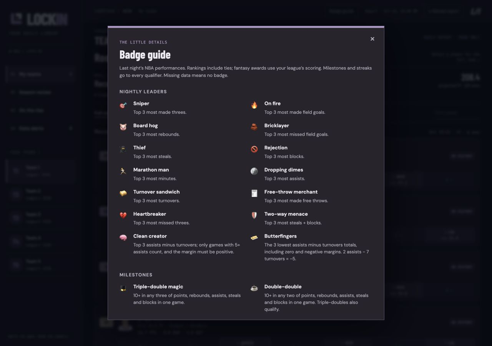
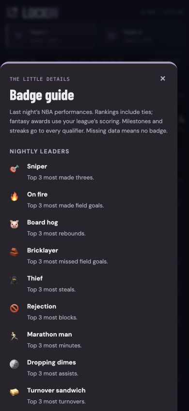
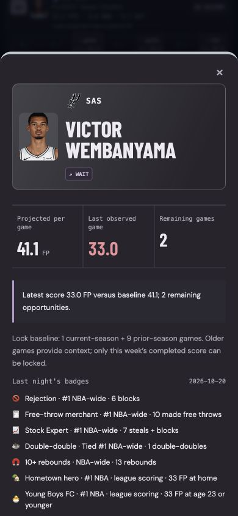

# Previous-night player badges and guide

Each refresh ranks the previous calendar day's observed NBA performances before
filtering to fantasy rosters. Box-score badges are identical across leagues;
fantasy-point badges use each league's own formula across the NBA player pool.

| Icon | Badge | Ranked stat |
| --- | --- | --- |
| 🎯 | Sniper | Made three-pointers (FG3M) |
| 🔥 | On fire | Made field goals (FGM) |
| 🐷 | Board hog | Rebounds |
| 🧱 | Bricklayer | Missed field goals (FGA − FGM); free throws excluded |
| 🥷 | Thief | Steals |
| 🚫 | Rejection | Blocks |
| 🏃 | Marathon man | Minutes played |
| 🪙 | Dropping dimes | Assists |
| 🥪 | Meatball sub | Turnovers |
| 🧾 | Free-throw merchant | Made free throws (FTM), not attempts |
| 💔 | Oh my goodness Valentine | Missed threes (FG3A − FG3M) |
| 📈 | Stock Expert | Steals + blocks; requires at least one steal and one block |
| 🧠 | Clean creator | Assists minus turnovers, with at least 5 assists per game and a positive margin |
| ☕ | Double-double | Number of games with 10+ in at least two of PTS/REB/AST/STL/BLK |
| 🎩 | Triple-double magic | Number of games with 10+ in at least three of PTS/REB/AST/STL/BLK |
| 🚀 | Above expectations | Largest positive actual FP − saved pregame projected FP |
| 🫠 | Below expectations | Largest shortfall below saved pregame projected FP |
| ⚡ | Minute maximizer | Highest fantasy points / minutes played |
| 🐌 | Slow night | Lowest fantasy points / minutes played |

## Milestones and contextual awards

The compact **Badge guide** button in the top bar opens a scrollable reference
panel. It does not add a main navigation tab or displace the roster. All **44**
indicators have an icon, name, and exact trigger; fantasy awards are labeled as
league-scored. Escape or the close button returns focus to the guide button.

| Icons | Single-game milestones |
| --- | --- |
| 🏹 / 💸 | 5+ / 10+ made threes |
| 📬 / 🧵 / 🎼 | 10+ / 15+ / 20+ assists |
| 🧲 / 🦍 / 🐄 | 10+ / 15+ / 20+ rebounds |
| 🛑 | 10+ blocks |
| 🦝 | 10+ steals |
| 🎬 / 💎 / 🌋 / ☄️ / 👑 | 30+ / 40+ / 50+ / 60+ / 70+ NBA points |

Every qualifying player receives a milestone, with **only the highest reached
tier per stat**. These are per-game thresholds, never summed across games.
They can coexist with leaderboard, double-double, and triple-double badges.

| Icon | Award | Trigger |
| --- | --- | --- |
| 🧈 | Butterfingers | Three lowest AST − TOV totals; 2 assists and 7 turnovers is −5. Zero and negative margins qualify; ties included. |
| 🌶️ | Three-game heater | Each of the last three observed season games strictly above the season FP average through last night. |
| 🧊 | Cold spell | Each of the last three observed season games strictly below that same average. |
| 🏆 | Winning effort | Highest single-game FP in a confirmed win. |
| 🥀 | In vain | Highest single-game FP in a confirmed loss. |
| 🚌 | Along for the ride | Lowest single-game FP in a confirmed win, excluding exactly zero FP; negative FP is eligible. |
| 🏡 | Hometown hero | Highest single-game FP by a home player. |
| 🦹 | Villain | Highest single-game FP by an away player. |
| 👴 | The Unction | Highest single-game FP by a player aged 32 or older on game day. |
| 🐣 | Young Boys FC | Highest single-game FP by a player aged 23 or younger on game day. |

The win/loss, home/away, and age awards select **first place, including ties**,
across the NBA for each league formula. The repeated request for the loss leader
is represented by one award. Age uses Sleeper birth dates, not a potentially stale
integer age; missing/invalid birthdays are excluded. Home/away and outcomes use
confirmed schedule context or observed NBA `MATCHUP`/`WL`. Ambiguous schedule
matches do not supply context. The validated Sleeper fallback now persists `WL`
after final box-score reconciliation in the same SQLite game payloads.

Streaks require a game last night and at least four current-season appearances.
The average includes the last three games and all other observed games in that
season through last night; all three must be strictly on the same side of that
average. It is not a comparison of just the three-game average. Prior seasons,
future games, duplicate records, and DNPs do not enter the comparison. Every
qualifier earns the streak, and its detail includes the season average. Opening
night cannot produce a three-game streak. Missing data is never manufactured to
fill the requirement.

New awards in `badge_awards.py` reuse observed full-season history, cached player
metadata and the existing season schedule. Raw milestones are computed once per
report; fantasy awards are shared by leagues with the same formula. No additional
service, website database, or scheduled job is introduced. Only public award
explanations cross the report allowlist; birth dates are not exported.

## Ranking and data rules

For the original ranked categories and Butterfingers, ranks use competition ranking: 1, 1, 3. Everyone in the first three places earns
the badge, including ties at third; this can mean more than three recipients.
Original raw-stat leader totals must be positive. Butterfingers and FP/min
rankings include zero and negative values. Contextual fantasy leaders also allow
zero and negative FP, except Along for the ride excludes exactly zero. Rates use total fantasy points divided by total minutes, excluding
zero-minute/DNP rows. There is no minimum-minutes threshold beyond positive
playing time: a short appearance can qualify. Exact ties use unrounded values.
Duplicate player/game records count once, with the last correction retained. Multiple games on a date are summed; the per-game forecast is multiplied by the number of observed games for that player-night.

Double-doubles and triple-doubles are derived per game before daily aggregation: separate sub-threshold games cannot combine into a milestone. Any two of points, rebounds, assists, steals, and blocks qualify for ☕; turnovers, minutes, and shooting counters do not. Triple-doubles also qualify for ☕ alongside 🎩. Tied qualifiers all receive the badge. Clean-creator scores use only games with at least five assists.

Missing, imputed, nonfinite, or invalid category inputs suppress the category.
A performance-provider failure suppresses all badges. Yesterday's real results
are required; older observations and forecasts never become actual performances.
The fallback feed retains three-point attempts alongside makes so missed threes
are measured rather than inferred from total field-goal misses.

## Forecast comparisons

`forecast_store.py` maintains a `forecast_snapshots` table in the existing local
`data/lockin.sqlite3`, separate from the observed `games` table. No website database
or new scheduled job is needed. Each real live refresh builds forecasts for NBA
players on teams with a verified pregame matchup that day, including players
outside the user's rosters, using the same projection source precedence as the
roster. Work is shared by leagues with the same scoring formula.

Snapshots are keyed by scoring-formula fingerprint, game date, and player ID.
A later pregame refresh may replace an earlier estimate. In-progress, completed,
canceled, or unknown-status games do not create or update forecasts. Past dates
cannot be backfilled. At the next refresh, actual results are compared with the
saved forecast for that date and exact formula; changing scoring rules does not
reuse a forecast from different weights.

The above/below badges rank only players with both an observed result and a saved
pregame forecast. The detail label shows actual versus projected FP and forecast
coverage, such as `60/68 players with saved forecasts`. Missing forecasts are
excluded, never replaced by postgame estimates. These badges begin after the
archive has accumulated pregame snapshots; installing this feature cannot recover
forecasts that were never saved. Test Week has no fabricated forecast archive,
so it shows observational/rate badges but no saved-forecast comparison badges.

## Display

Roster rows show at most three 11–12px icons, ordered by rank then category, and a
small `+N` for extras. Hover for the stat/rank/date or tap the player to see all
badges. League-scored awards explicitly say `NBA · league scoring`. Badges do not
change points, lock decisions, projections, or recommended lineups.

The date follows the existing Edmonton report clock and NBA game dates. The
browser hides badges when they no longer represent yesterday, including after
midnight or waking an open tab. Expired/failed reports hide them too. Test Week
uses its simulated date. No games yesterday means no icons.

`daily_badges.py` computes stat rankings once per report and fantasy rankings once
per scoring formula. `pages.py` allowlists badge identity, rank, value, tie, scope,
and optional actual/projected FP and coverage. Original raw-stat categories belong in
`CATEGORIES`; original fantasy categories use `fantasy_night_badges()`. New
thresholds and contextual categories live in `badge_awards.py`. Icons, labels and
guide rules share one catalog in `web/insights.js`.

The [expanded badge example](screenshots/expanded-badges-mobile.png) uses generic
team labels and real stored October 20 results. The earlier [desktop sample](screenshots/daily-badges-desktop.png)
and [phone sample](screenshots/daily-badges-mobile.png) use December 25, 2025
practice results and predate the new categories. None establishes model accuracy.

## Guide previews

These captures show the guide with generic team labels; they demonstrate layout,
not model accuracy. The older expanded-player image above predates this guide and uses the previous badge names/icons. The current names include Meatball sub, Oh my goodness Valentine, Stock Expert, The Unction and Young Boys FC.

The expanded player card keeps a small NBA logo beside its team abbreviation above the name and stats.

## Season totals

The dedicated **Badge race** tab (`data-view="badges"`) retains earned indicators
for the whole season, even after previous-night icons expire. It defaults to an
NBA-wide view and provides a current-roster toggle, every individual badge
leaderboard, and cards for total awards, negative (Chaos) leaders, milestones,
and badge variety. Distinct badge variety is capped at 43 (or 42 for ages 24–31
or unconfirmed birthdays) because the age-based awards (*The Unction* $\ge 32$ and
*Young Boys FC* $\le 23$) are mutually exclusive. Refreshes reuse the same award
rules and update `badge_days` / `badge_awards` in the existing SQLite file. One
player/badge/night counts once; ties remain eligible. Coverage reflects stored
observations and genuine pregame forecasts, not invented past awards.
