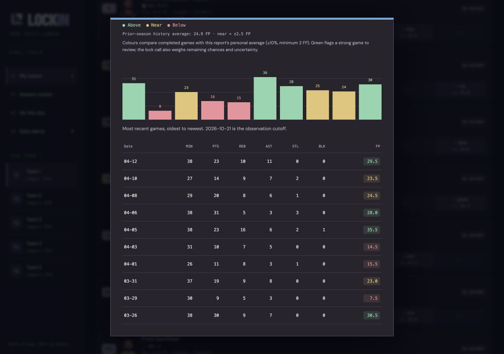
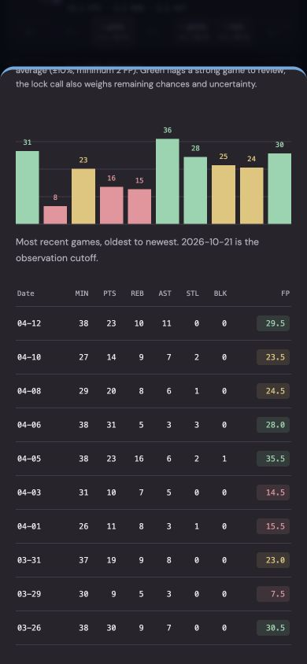
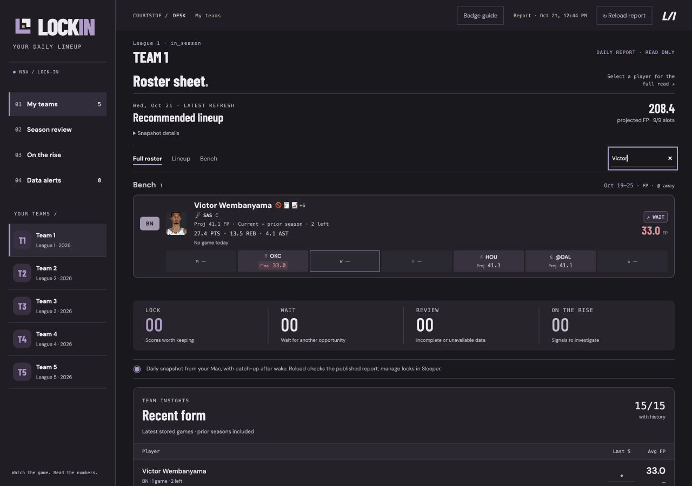

# Player performance colours

The expanded player card has a larger NBA logo (34 px desktop, 28 px phone), a
readable abbreviation, and a muted team-colour header and top border. The rest of
the application keeps the charcoal/plum palette. Team accents are presentation
choices; they never encode good/bad performance.

## One comparison everywhere

Completed game scores use the same `performanceScore()` helper in
`web/insights.js` for:

- Recent-history bars and the FP column in the expanded player card.
- Last observed game and completed scores in the card's weekly schedule.
- Completed weekly roster tiles and the latest FP total beside the lock call.

The personal average comes from the report's `fp_mean_recent` when available.
This is the model's recency-weighted baseline and retains its current/prior-season
blending for sparse current-season history. For prior-season-only cards, or when
that field is unavailable, the comparison uses the mean of valid stored history
(up to 25 observations in the report), requiring at least two observations.
Future history beyond the report cutoff is excluded. The average is specific to
the player's league scoring formula; it is not a league-wide average or a claim
about Sleeper's own colouring algorithm.

| Colour | Rule |
| --- | --- |
| Green | Score exceeds average + near-average band |
| Yellow/amber | Score is within the band, including both boundaries |
| Red | Score is below average − band |
| Neutral | No usable average or no observed score |

The band is `max(2 FP, 10% × abs(average))`. For a 40 FP baseline, 36–44 FP is near
average. Negative scores and negative/zero baselines keep their signed comparison.
Projections, pending scores and missing data are never coloured as performances.
Exact totals stay visible; hover/accessibility descriptions state above/near/below
and the comparison baseline. The chart includes a written legend and rule.

These are retrospective comparisons to the **current report's** baseline, not
historically archived pregame evaluations. Older games may change colour after a
refresh changes the baseline. Prior-season charts say which history they show.

Green highlights strong performances worth reviewing for a lock. The existing
lock model still evaluates the completed score, player variability, remaining
opportunities and available history; no automatic LOCK is inferred from colour.
No scoring, projection, database schema or scheduling logic changes here.

## Examples

These use real stored observations with generic fantasy-team labels. They show
layout and comparison behaviour, not predictive accuracy.

