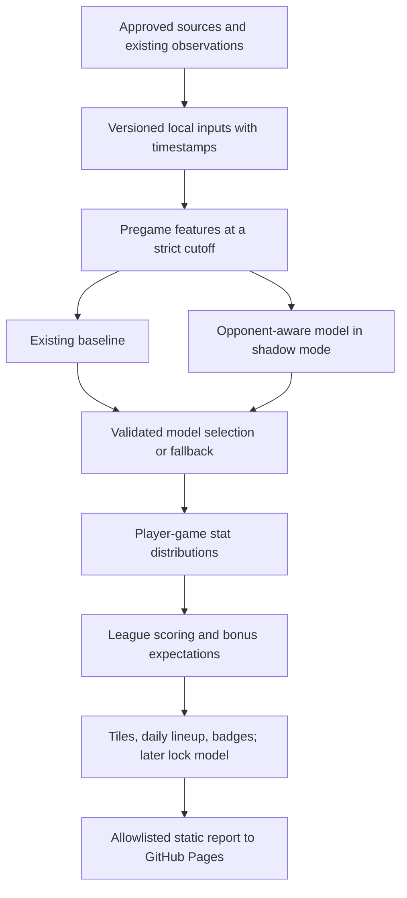

# Epic proposal: opponent-aware player projections

**Status:** proposed; not implemented or approved for implementation.  
**Prepared:** October 21, 2026.  
**Code baseline reviewed:** `2961775`.  
**Scope of this change:** research and documentation only. No model, database,
provider, scheduler, UI, or publication behavior changes.

**Development plan:** evaluation and opponent factoring will be implemented on a
separate branch later, at the user’s direction. No branch is created now. The
[backend evaluation epic](MODEL_EVALUATION.md) expands OPP-04 and OPP-11 into shared
per-game and weekly-lock scorecards, plus operational benchmarks.

## 1. Outcome and recommendation

Produce a separate forecast for each player and upcoming NBA game, using the
player's scoring/rebounding/playmaking profile, the opponent's corresponding
strengths and weaknesses, expected opportunities, and information available at
publication time. Apply each fantasy league's scoring formula **after** projecting
the basketball statistics.

A high-volume three-point shooter and a paint-focused center should not receive
the same adjustment against the same opponent. A slow opponent may reduce both
players' opportunities, while its shot profile could affect their efficiency in
different directions. These are hypotheses to test, not guaranteed effects.

**Recommended route:** preserve today's model as the benchmark and fallback;
build reproducible pregame data snapshots; introduce a small, regularized
component-level adjustment model; test it out of sample; expand only where extra
data demonstrably helps. Keep one authoritative local SQLite database and the
existing static website. No website database is needed.

“Use all our stats” should mean audit every available field and retain useful
history, not force every field into the prediction. Redundant variables, unstable
splits, and unavailable-at-prediction-time information can reduce accuracy.
More detail is valuable only when it survives measurement and can be maintained.

### Product acceptance examples

- Wednesday and Saturday tiles can show different projections for the same player.
- Player details explain the baseline, matchup adjustment, affected components,
  forecast time, and data coverage without implying certainty.
- The daily lineup uses the forecast for that day's specific game and the
  existing league-specific positional constraints.
- Two leagues reuse the same basketball forecast and obtain different FP values
  from their scoring rules, including milestone bonuses.
- If opponent context fails, the player retains a clearly labeled valid baseline;
  missing context never becomes a zero forecast or an invented favorable matchup.
- The roster sheet stays the primary view. Supporting explanations stay in details.

## 2. Verified starting point

This inventory comes from a read-only source/database audit on the date above.
Counts describe that snapshot, not permanent coverage guarantees.

| Existing asset | Verified behavior or coverage | Implication |
| --- | --- | --- |
| [`lineup.py`](../../lineup.py), `project_players()` | One per-player baseline, using games strictly before the reference day; recency weights and sparse-season historical blending | Preserve as benchmark; target-game identity and context must be added separately |
| [`projections.py`](../../projections.py) | Validated Sleeper/RotoWire season-level per-game forecasts fill current-history gaps | Do not assume the vendor's underlying context or adjustment method is known |
| [`season_history.py`](../../season_history.py) | Previous observations fill the configured window while current-season history is sparse | Retain cold-start support; estimate new context priors separately |
| Local `games` table | 68 player-game observations from 3 games on October 20, 2026; 2026–27 only | Insufficient current-season evidence to learn opponent effects alone |
| Live observation fields | Minutes, core box-score stats, FGM/FGA, FTM/FTA, FG3A, team abbreviation, matchup, source; OREB/DREB/PF columns also present; no numeric TEAM_ID in these rows | Column presence is not a field-quality guarantee; audit sparse-zero semantics and provider differences before new features |
| Separate 2025–26 fixture | 26,648 player-game rows, 582 players, 1,230 regular-season games; finalized team schedule | Useful retrospective experiment input, not an authentic pregame information archive |
| Separate 2024–25 fixture priors | 26,300 player-game rows | Another season of box scores, not just scalar prior averages |
| Historical fixture fields | Core stats, FGM/FGA, FTM/FTA, minutes, teams and matchups; no FG3A, OREB, DREB, PF, shot coordinates, or possession sequences in the normalized tables | Cannot train historical three-point-attempt, rebound-split, or tracking models from these tables alone |
| [`schedule.py`](../../schedule.py) | Game IDs, dates, home/away teams, statuses, and final team points; no retained precise tip-off timestamp | Add canonical identity and timestamp support before deadline-aware forecasts |
| [`forecast_store.py`](../../forecast_store.py) | 1,059 rows for October 21 across three scoring fingerprints; keyed by formula/date/player; later pregame captures replace earlier ones | Suitable existing badge benchmark, insufficient experiment/version history; no archived stat vectors or target game IDs |
| [`game_store.py`](../../game_store.py) | Upserts corrections and reconciles provider IDs; latest values retained | Good operational store; cannot reconstruct every previous information state |
| Current report/UI | One baseline repeated in upcoming tiles; public weekly-game allowlist omits game ID | Both report contract and presentation need deliberate migration |
| [`model.py`](../../model.py) | Lock comparison uses a common future distribution and remaining-game count | Matchup-specific locks need a later, separately validated change |

The database does not currently contain historical pregame injury reports,
rotation expectations, defender assignments, play-by-play, tracking, complete
forecast revisions, or a trained opponent model. The fixture schedule is finalized,
and current roster metadata must not be treated as historical membership. See
[historical replay](../HISTORICAL_REPLAY.md) and [current projections](../PROJECTIONS.md).

## 3. Information worth collecting or deriving

### A. First release candidates: existing box scores and schedules

Build full NBA team/opponent histories, not aggregates of the user's fantasy
rosters. Use only completed observations available before the forecast cutoff.

| Feature family | Player-side profile | Opponent/game context | Important qualification |
| --- | --- | --- | --- |
| Opportunity | Minutes distribution, starts if actually known, FGA/min, AST/min, rebound/min | Home/away, rest days, back-to-back, recent workload | Rest means schedule rest, not a diagnosis of fatigue |
| Scoring | Shot volume, FGM/FGA, FTM/FTA, made-three share | Opponent attempts/makes/FT allowed, turnover pressure | Raw points allowed confounds pace and opponent quality |
| Rebounding | Total rebound rate; split rates only with verified inputs | Missed-shot opportunities and rebound capture | Player rebound sums omit team rebounds; do not call them exact team totals |
| Playmaking | Assists relative to minutes and team makes | Opponent assist environment, turnover forcing | Team shooting conversion and player role also matter |
| Defensive stats | Steals and blocks per opportunity proxy | Opponent turnovers, shot volume and eventual shot-location mix | Rare-event estimates need strong shrinkage |
| Context change | Recent vs longer-run role, team changes | Opponent lineup continuity, coaching changes when sourced | Names/current team fields cannot establish past assignments |

FGA minus FG3A can identify two-point attempts **only when FG3A is observed**.
FGM minus FG3M identifies two-point makes. Do not infer missing attempts from a
shooting percentage guess. Do not interpret FG3M/FGA as a three-point attempt rate.
For initial cross-season work, either restrict to the shared trustworthy feature
set or obtain a licensed historical backfill; do not silently replace unavailable
columns with zeros.

Aggregate both sides of each game and reconcile against independent final totals.
Incomplete games cannot produce a seemingly elite defense. Estimate possessions
only when required team totals and rebound splits are valid; label approximations.
Normalize volume by opportunities so pace is not rewarded or penalized twice.

### B. Highest-value enrichment to investigate

1. **Team possessions and advanced team/opponent statistics.** Establish pace,
   defensive efficiency, turnover rates, rebound capture and free-throw rates.
   Prefer validated game-level inputs over only today's season aggregates.
2. **Shot locations and types.** Player rim/midrange/corner-three/above-break
   exposure against opponent concessions in the same zones. Separate allowed
   attempts from allowed conversion. Sparse shooting percentages require shrinkage.
3. **Timestamped injuries and expected rotation.** Teammate absences change usage
   and minutes; missing opposing defenders change matchup context. Preserve the
   report as it existed at prediction time. “Questionable” is not a calibrated
   probability and “returning” does not establish a minutes restriction.
4. **Play-by-play and lineup stints.** Possession counts, rebound opportunities,
   on/off roles, and combinations of teammates/opponents. Validate substitutions,
   event ordering, overtime, and totals before using derived features.
5. **Tracking/play types.** Potential assists, touches, rebound chances, drives,
   catch-and-shoot vs pull-up, pick-and-roll, post-ups, and defensive assignment
   probabilities. These are later candidates, subject to coverage and rights.

Optional later research: travel distance and time-zone transitions using verified
venue schedules; non-betting use of timestamped market consensus as a separately
licensed benchmark. Market data is not needed for the core model. No speculative
“revenge game,” social sentiment, or unverified news multiplier is proposed.

### C. Source shortlist and acquisition decision

Documentation was inspected on October 21, 2026. **Documented fields are not proof
that a live endpoint works from this Mac, has usable historical coverage, or allows
this application's use.** No new data subscription or ingestion is authorized here.

| Candidate | Evidence and possible use | Maintenance/access decision |
| --- | --- | --- |
| Existing local store and immutable fixtures | Audited above; fastest source for first experiments | Preserve source provenance and fixture hashes; separate retrospective and prospective evaluation |
| NBA Stats through `nba_api` | [Team stats](https://raw.githubusercontent.com/swar/nba_api/master/docs/nba_api/stats/endpoints/leaguedashteamstats.md) documents advanced/opponent modes and date filters; [shot locations](https://raw.githubusercontent.com/swar/nba_api/master/docs/nba_api/stats/endpoints/leaguedashteamshotlocations.md) documents zone counts; [shot charts](https://raw.githubusercontent.com/swar/nba_api/master/docs/nba_api/stats/endpoints/shotchartdetail.md) documents game/date filters | Candidate schemas, not a service guarantee. Some endpoint documentation was last validated in 2020. Existing project already experiences NBA request failures; require a source spike and a permitted-use decision |
| NBA defender/play-type data | [Defended shooting](https://raw.githubusercontent.com/swar/nba_api/master/docs/nba_api/stats/endpoints/leaguedashptdefend.md) and [play types](https://raw.githubusercontent.com/swar/nba_api/master/docs/nba_api/stats/endpoints/synergyplaytypes.md) document richer categories | Later experiments only. Check date-filter support per endpoint; a present-day season aggregate cannot reconstruct historical cutoffs. Closest-defender data does not prove future primary assignment |
| Official NBA injury reports | [Season report page](https://official.nba.com/nba-injury-report-2026-27-season/) publishes dated reports and describes updates throughout the day | Archive source timestamp plus first retrieval time; parsing and historical coverage need validation. Daily publication will miss later news |
| `pbpstats` | [Maintainer documentation](https://pbpstats.readthedocs.io/en/latest/) describes possessions, lineup-on-floor data, shot-zone breakdowns and event-order repairs | A parser, not an independent replacement data source or data license. Cache permitted raw responses and test reconstruction errors |
| BALLDONTLIE | [NBA API documentation](https://nba.balldontlie.io/) lists player stats, advanced stats, lineups, injuries and plays; API key required and relevant endpoints are tier-gated | Potential alternative adapter. Confirm exact season/endpoint coverage, pagination, current price/rate limits and derived/public-output rights before selecting it |
| Sportradar | [NBA reference](https://developer.sportradar.com/basketball/reference/nba-overview) documents schedules, game events, advanced metrics and correction logs; [daily injuries](https://developer.sportradar.com/basketball/reference/nba-daily-injuries) is a separate feed | Possible licensed reliability upgrade. Obtain product-specific scope and quote; accessing Sleeper's existing feed is not a direct Sportradar entitlement |

NBA Statistics terms restrict fantasy and database uses; treat NBA-direct
enrichment as rights-gated for this project. [NBA terms, section 9](https://www.nba.com/termsofuse).
A package's open-source license does not grant rights to the underlying sports
data. The source spike must document storage, model training, derived forecasts,
public static publication, retention, and attribution permissions. Do not build
the epic around a source that cannot support the intended use. No access-control
workarounds or unlimited scraping assumptions belong in the plan.

## 4. Model design

### 4.1 Define the prediction target first

For player `p`, game `g`, and publication cutoff `t`, distinguish:

- Distribution of minutes and statistics **conditional on playing**.
- Probability of playing, only if a separately evaluated availability model exists.
- Scheduled participation and optimizer eligibility from verified inputs.

The current UI's baseline is conditional on playing. Preserve that meaning in the
first release. A later unconditional estimate may use
`P(plays | information at t) × E(FP | plays, information at t)`, but must be clearly
labeled. Training a participation model requires an eligible-player universe with
verified DNP/absence labels: today's positive-minute observations alone cannot
supply those negatives. Do not multiply a conditional forecast twice by availability.

### 4.2 Learn opponent effects relative to player expectations

Start with regularized models of per-stat opportunity/rate residuals, rather than
one blanket defense rank multiplier or a separate model for every player-opponent
pair. A team's weak schedule can make its raw defensive numbers look strong.

One candidate model for a nonnegative event count `Y_k` is:

```text
log E[Y_k | plays] = log(expected exposure)
                  + player_rate_prior_k
                  + opponent_effect_k
                  + context_coefficients_k · context
                  + player_style · interaction_matrix_k · opponent_profile
```

`expected exposure` is either expected minutes or expected on-court possessions,
with consistent units. Coefficients, shrinkage, and interaction complexity are
learned on training folds. A count model, a regularized residual model, and a
simple empirical baseline should compete; this equation is a design candidate,
not a chosen fit or an accuracy claim.

Learn offensive/player and defensive/opponent effects jointly, or use
out-of-fold pregame baselines to estimate opponent residual effects while
controlling for offensive strength and pace. Center opponent effects around a
league reference. Identification and regularization matter: avoid interpreting
correlated offensive and defensive terms as independent causal contributions.

**Baseline context must be accounted for.** Recent averages already include the
pace and opponents faced. Apply the difference between upcoming context and the
weighted context of the baseline window, or learn a neutral-context rate first.
Blindly multiplying a recent average by pace and defense ratios double-counts
context. Vendor forecasts need their own validated calibration path; if their
context is unknown and training support is absent, retain the unadjusted fallback.

### 4.3 Predict opportunities before results

- **Minutes:** recency, role stability, rest, teammate availability and rotation
  scenarios. Constrain coherent team totals to 240 regulation minutes, with an
  explicit overtime scenario. Do not allocate every player's conditional minutes
  simultaneously across mutually exclusive availability scenarios.
- **Pace:** predict the two teams' shared game environment; translate to player
  exposure. If using possessions/minute, do not add another blanket pace boost.
- **Shots:** forecast FGA, two/three-point allocation, and make probabilities.
  Use binomial/beta-binomial-style candidates for makes given attempts, with
  regularization for sparse attempts; learn shot-mix changes as well as efficiency.
- **Free throws:** attempts/opportunities and conversion, rather than independent
  FTM and FTA regressions that can contradict each other.
- **Rebounds:** missed-shot opportunities and player share; split offensive and
  defensive only when supported. Otherwise retain the approved total-rebound path.
- **Assists:** creation opportunities, role, teammate conversion and opponent
  context. Potential-assist data is an enhancement, not an assumed existing field.
- **Steals, blocks, turnovers:** appropriate count models with exposure offsets;
  compare Poisson with overdispersed alternatives on held-out data.

Derive consistent scoring totals: `FGM = 2PM + 3PM`, `FGA = 2PA + 3PA`, and
`PTS = 2 × 2PM + 3 × 3PM + FTM`. Require makes ≤ attempts, nonnegative counts,
and coherent rebound splits. Treat historical corrections and scoring anomalies
as validation cases rather than forcing raw data to match by fabrication.

### 4.4 Represent strengths and weaknesses without brittle positions

Begin with continuous player profiles: shot volume, made-three/attempt profile
where available, free-throw pressure, creation, rebounding, defensive event rates,
and minutes/usage stability. Add zone/play-type distributions when data supports
them. A fantasy PF/C label is not a defensive assignment or offensive archetype.

Illustrative interactions to test:

| Player trait | Relevant opponent trait | Candidate response |
| --- | --- | --- |
| High three-point attempt share | Three-point opportunities and conversion allowed | Adjust 3PA share and make probability separately |
| Rim-oriented scorer | Rim attempts conceded and rim protection | Change rim volume/efficiency, not all stats equally |
| Strong rebound capture | Opponent miss volume and rebound competition | Change opportunities and share |
| Primary creator | Pressure/turnover forcing and assist concessions | Adjust turnovers and assists with role/pace controls |
| Shot blocker | Opponent rim exposure and shot mix | Adjust block opportunities with strong shrinkage |

Head-to-head history may be a heavily shrunk secondary feature, never the default
model. Tiny samples, trades, teammates, coaches and roles make “last three versus
this opponent” fragile. Direct defender matching is an optional probability-weighted
mixture over likely defenders/stints, not a claim that one defender guards a player
all night. Learning low-rank interactions or more complex archetypes comes only
after simpler models show reproducible gains.

### 4.5 Sparse data, changing roles and uncertainty

Use hierarchical pooling from player to role/profile to league, and from current
team context to prior seasons/league. Effective sample size must reflect recency
weights and opportunity counts, not merely games. Tune shrinkage on past folds;
rare events and narrow zones need stronger pooling. A diagnostic weighted sample
size is `(sum weights)^2 / sum(weights^2)`; it does not resolve serial dependence.

Returning players retain skill priors but get fresh uncertainty about minutes and
role. Team changes and major rotation changes reduce reliance on old team context.
Rookies without suitable priors use available validated forecasts or population
priors with wider uncertainty, not invented NBA histories. Prior-season weighting
need not follow the same schedule for minutes, shooting skill and team defense.

Return predictive intervals and coverage labels. Sample joint box scores using
shared minutes/pace/role variables and validated residual dependence. Independent
sampling of every stat can distort DD/TD chances and FP tails. If an interval is
not calibrated, call it an experimental range; never label a heuristic score as
a confidence probability.

### 4.6 Rescore once the basketball forecast exists

For league `L`, define `S_L(box_score)` using existing scoring rules. Estimate
`E[S_L(Y)]` by exact expectation where available or by scoring joint simulated
box scores. This preserves stacked milestones, DD/TD bonuses, negative weights,
and approved foul/rebound omissions. Never apply a threshold bonus to the mean
stat line. Negative fantasy points are valid even though raw counts are nonnegative.

Share a versioned distribution/stat forecast across leagues; cache scoring by the
full formula **and scoring-policy version**, including approximation choices.
Changing a league formula should not refetch NBA data or retrain the sports model.
Keep today's empirical/Poisson bonus behavior as the explicit baseline until the
new joint model passes its own tests.

## 5. Local architecture and proposed data contracts



Keep operational tables in the existing SQLite database. Versioned model files
and immutable research datasets can remain local artifacts with manifests; they
are not a second authoritative database. These are proposed logical tables,
not migrations performed by this document:

| Proposed contract | Key / essential fields | Reason |
| --- | --- | --- |
| Entity and game aliases | Provider ID → canonical player/team/game ID; season and validity interval | Reconcile NBA/Sleeper/paid sources without joining by name or date alone |
| Source snapshots | Source, request scope, payload hash, fetched_at, published_at if supplied, schema version, status, permitted raw payload or reference | Replay the information actually available; detect schema changes |
| Observation revisions | Canonical game/player, source snapshot, revision ID, valid/event time, values, superseded revision | Retain corrections without rewriting experiment inputs; existing `games` can remain the latest-value view |
| Schedule/availability snapshots | Game ID, scheduled UTC tip-off, venue/timezone, status, membership/availability effective time and known time | Resolve postponements, trades and prediction deadlines |
| Team-game/possession records | Canonical game/team/opponent, reconciled counters, possessions method, quality flags | Shared context for all players and leagues |
| Feature snapshots | Player/game/cutoff, feature version, input snapshot IDs, missingness, effective samples | Deterministic training and serving parity |
| Model runs | Model/config/code version, data manifest, training end, validation folds, metrics, calibration, seed | Reproducibility and rollback |
| Player-game predictions | Player/game, issued_at, forecast horizon, model/feature versions, stat distribution/parameters, baseline, status, explanation | Preserve every issued forecast revision, including future games |
| League-scored predictions | Prediction ID, formula/policy fingerprint, FP mean/quantiles/bonus expectations | Reuse one sports forecast without blending league labels |

Retain existing forecast snapshots for badge compatibility. Future migration should
add an append-only prediction ledger and a deliberate “selected pregame prediction”
view. Do not pretend old FP-only records contain missing components or model
versions. A manual refresh creates a revision; it must not erase the earlier
prediction used in a retrospective evaluation. Baseline and challenger IDs stay
separate so badges cannot cherry-pick the more flattering comparison after the game.

### Time and identity rules

- `event_time` answers when the game/report applies; `known_at` answers when the
  application could use it. A correction acquired tomorrow cannot enter yesterday's
  prospective features. When publication time is unknown, use retrieval time as the
  conservative availability bound.
- Use UTC instants for cutoffs and preserve NBA game dates plus the existing local
  publication timezone. A date alone cannot establish a precise pregame deadline.
- Historical backfills acquired now are **retrospective reconstructions**. Do not
  backdate `known_at` to manufacture a prospective archive.
- A game keeps canonical identity across postponements and provider aliases.
  Ambiguous joins go to quarantine; date/player matching alone is insufficient.
- Basketball team membership is time-dependent and separate from fantasy roster
  ownership. Train on all available NBA players, not just current fantasy rosters.
- Never use target-game actual minutes, starters, final scores, final injury outcome,
  end-of-season aggregates, or future roster assignments as forecast features.

## 6. Sustainable refresh and scaling

Preserve the current daily Mac refresh and wake catch-up. Matchup modeling does
not require an always-on service. However, daily forecasts cannot reflect late
scratches after publication; label forecast age and conditional assumptions. A
future extra pregame refresh is a separate product/cost decision, not enabled here.

**Ingestion:** shared league-wide batch requests, incremental overlap windows,
provider-specific correction reconciliation, bounded retries/backoff, request
budgets, persisted checkpoints and per-source freshness. Fetch once per source
scope, not per fantasy team or player. Schedule expensive historical backfills as
resumable maintenance, never inside a normal refresh.

**Computation:** precompute reusable team/player rolling aggregates. Avoid a new
full-history scan for every player × opponent × league. Generate only scheduled
player-game forecasts, then score distinct formulas. Cache keys include input
snapshot, game, cutoff, model and feature versions; invalidate affected aggregates
when historical corrections arrive.

**Training:** run separately from publication on a measured cadence, initially
weekly only if justified; inference always uses a known model artifact. Training
failure leaves the last validated model in service. Never promote a model merely
because retraining completed or a new season began.

**Storage:** transactional batches and the existing single-writer refresh lock;
indexes on canonical IDs, event dates and cutoff timestamps. Measure database
size/query plans before changing engines. Preserve forecast/feature manifests;
compress large permitted PBP/raw payloads, checkpoint and back up consistently,
and test restoring model + database together. Set retention from reproducibility
requirements and source permissions, not unlimited raw-data collection.

**Degradation:** richer context → team-level context → approved baseline → genuinely
unavailable. A missing optional source should not take down the roster. Record
missingness, context age, fallback reason and coverage per forecast. Never silently
substitute a definition from another provider into the same feature version.

**Proposed budgets, to ratify at kickoff:** normal model inference under 60 seconds
on the existing Mac; optional enrichment adds no more than five minutes to a normal
refresh before falling back. Measure rather than promise these values. No paid
service until a specific provider, budget and publication rights are approved.
Track p50/p95 latency, requests, cache hits, fallback frequency, input lag, disk
growth and training cost. SQLite remains the default; consider a server database
only if measured multi-user/concurrency requirements exceed it, not merely because
additional seasons exist.

## 7. Integration plan and compatibility

| Component | Proposed change | Compatibility rule |
| --- | --- | --- |
| Providers / ingestion | New optional adapters and canonical snapshot contracts | Existing daily history and source fallbacks continue to work |
| `lineup.py` / projection service | Add player-game forecast lookup beside the current player baseline | Unknown matchup falls back explicitly; retain per-player fallback API |
| `engine.py` | Build shared context once; attach per-game forecasts to scheduled rows | No extra fetch per fantasy league; use target dates, not report date everywhere |
| `forecast_store.py` / badges | Store versioned game forecasts and a deterministic pregame selection policy | Existing saved comparisons remain valid; no postgame reconstruction |
| `pages.py` / report schema | Allowlist canonical game ID, forecast timestamp, model/source, stat/FP summary, coverage and concise reasons | Version the report or use explicit capability detection; old reports render baseline safely |
| `web/insights.js` / weekly tiles | Prefer matching game-specific forecast, otherwise labeled baseline | Never match only by weekday/opponent; finals remain actuals; canceled games are not projected |
| Daily optimizer | Use each candidate's relevant game projection, or sum games if genuinely applicable | Preserve position eligibility, reserves, known-out exclusions and one assignment per player |
| Player details | Baseline → adjusted FP, key stat changes, range/sample/source | A model attribution is an explanation of the calculation, not a causal fact |
| Season review | Continue using observed scores only | Forecasts never enter actual team production |

**Locks are a later sub-epic.** Once calibrated per-game distributions exist,
replace the common-distribution comparison with each remaining game's distribution.
Under independence, `P(any future FP > current) = 1 − product(F_game(current))`.
Shared injury/role uncertainty can violate independence; evaluate joint scenarios
before claiming improved lock decisions. Existing decision heuristics and thresholds
need separate validation. Do not quietly change them as part of the first tile or
lineup release. Already-started games must not receive a new “pregame” forecast.

## 8. Accuracy and evaluation protocol

### Baselines and experiment ladder

Freeze the current production model and scoring policy as benchmark B0. Compare:

| Candidate | Added complexity | Question answered |
| --- | --- | --- |
| B0 | Current recency/prior/fallback behavior | Does any change beat what users actually have? |
| B1 | Improved minutes and role only | Is the gain opportunity modeling rather than matchup knowledge? |
| M1 | Pace, home/rest, regularized team-level opponent residuals | Does basic opponent context add independent value? |
| M2 | Player-style × opponent-stat interactions | Do individual strengths/weaknesses improve predictions? |
| M3 | Zones, lineup/availability scenarios, possession-level features | Does enrichment justify its cost and missing-data risk? |
| M4, optional | Gradient-boosted residual model or hierarchical latent interactions | Does a more flexible model outperform the interpretable alternatives? |

Deep networks and exact defender assignment are not prerequisites. Test one feature
family at a time. Use ablations, regularization, and held-out model selection;
retain a simpler model if richer inputs do not help. Do not insert all correlated
metrics as separate multiplicative boosts.

### Splits and information cutoffs

1. Target several seasons of licensed/reproducible history (initial goal: 3–5),
   but begin feasibility experiments with the two seasons already available.
2. Use chronological walk-forward train/validation/test blocks. Reserve an untouched
   final block, tune only on earlier blocks, and keep every player's rows from the
   same game/date in the same split. Fit scaling, imputation, archetypes and
   calibration on training data only.
3. Build all rolling features by shifting past the prediction cutoff. Evaluate the
   actual daily publication horizon, plus one/two/several-day-ahead forecasts
   separately. Tomorrow's forecasts cannot use today's still-unplayed result.
4. Keep two experiment classes: retrospective box-score reconstructions and genuine
   prospective snapshots. Finalized schedules/corrected history do not prove
   real-time performance. Historical vendor forecasts and injury context cannot be
   invented where no archive exists.
5. Log all scheduled-player predictions, not only players ultimately selected or
   earning badges. Report missingness and paired evaluation coverage to avoid
   apparent gains achieved by dropping difficult cases.

The [scikit-learn time-series splitter documentation](https://scikit-learn.org/stable/modules/generated/sklearn.model_selection.TimeSeriesSplit.html)
explains time-ordered splits. This dataset needs additional date/game grouping;
a plain row-index split is insufficient for uneven player-game panels.

### Measures

- Stat-component MAE/RMSE and signed bias; shooting/count likelihood where valid.
- FP MAE/RMSE for each formula, plus a normalized cross-formula summary. Do not
  pool raw errors so a high-scale scoring formula dominates.
- Minutes error separately from per-minute production error.
- Predictive-interval coverage and width; CRPS or quantile loss for distributions;
  Brier scores/reliability for milestone and availability probabilities.
- Slices: early season, rookies, injury return, trades/role changes, low-minute
  players, stars, positions/styles, source/fallback tier, forecast horizon and season.
- Lineup decision quality on frozen pregame eligible pools: realized score and
  hindsight-optimal score under identical slot rules, with DNPs handled consistently.
  Label hindsight regret as a diagnostic, not an achievable forecast. Current
  fantasy rosters do not establish historical eligible pools or ownership.
- Later lock evaluation: calibration of beat-current probabilities and replay of
  the actual sequential policy; ranking error alone cannot establish lock quality.

Calculate paired uncertainty intervals clustered by game/date or week, rather
than treating every player row and overlapping rolling window as independent.
Account for repeated model/feature searches with an untouched final test and
prospective shadow run. Report improvements and regressions, not only the best run.

### Proposed promotion gate

Agree exact thresholds **before** selecting a winner. A starting proposal:

- Zero observed leakage/identity violations; deterministic replay and fallback tests pass.
- At least 2% lower macro-average league FP MAE than B0 on the untouched test,
  with a paired block-bootstrap 95% interval favoring the candidate; also compare
  against B1 to isolate opponent value. These are targets, not measured results.
- No material degradation in RMSE, major league formulas or adequately sampled
  critical slices; define slice tolerances and minimum support at kickoff.
- Declared predictive intervals and milestone probabilities meet pre-registered
  calibration tolerances; no narrower range merely for visual appeal.
- Prospective shadow collection for at least 30 NBA game dates and 2,000 observed
  player appearances, spanning varied teams/context; these are minimum floors,
  not statistical proof. Extend if confidence or critical-slice support is inadequate.
- Operational budgets, source permissions, outage behavior and rollback verified.

If the gate fails, keep B0 serving users and retain the experiment for research.
Neither a working pipeline nor a plausible basketball explanation establishes accuracy.

## 9. Delivery backlog for epic kickoff

Each item ends with a reviewable artifact. No ticket below has been executed by
creating this proposal.

| ID / phase | Deliverable | Depends on | Exit criterion |
| --- | --- | --- | --- |
| OPP-01: contracts and scope | Approved target/horizon, conditional semantics, source budget, metrics, promotion thresholds and lock scope | Kickoff approval | Written decisions and explicit exclusions |
| OPP-02: source/coverage spike | Source permission record, bounded endpoint samples, historical field/season matrix, latency/correction assessment | OPP-01 | At least one viable permitted source path; missing features explicitly removed or deferred |
| OPP-03: identities and snapshots | Migration design, canonical aliases, timestamped revisions, backup/restore procedure | OPP-02 | Ambiguous joins rejected; correction/postponement/trade cases replay correctly |
| OPP-04: benchmark and time-safe evaluator | B0 reproduction, game/date folds, frozen manifests, leakage tests and scorecards | OPP-03 | Can reproduce results without network access and distinguish retrospective from prospective evidence |
| OPP-05: opportunity baseline | B1 minutes/role model with uncertainty | OPP-04 | Separately measured opportunity gains; valid participation-label policy |
| OPP-06: opponent model MVP | M1 regularized team context and M2 basic style interactions | OPP-04, OPP-05 | Ablation results; same-day/future inputs excluded; no claim of production readiness |
| OPP-07: distributions and scoring | Joint stat samples/parameters, calibrated intervals and bonus expectations | OPP-06 | Physical/statistical invariants and formula tests pass; compare with current bonus baseline |
| OPP-08: shadow publication pipeline | Append-only predictions, source/fallback telemetry, reproducible model registry | OPP-07 | Collect prospective forecasts without affecting visible projections or decisions |
| OPP-09: controlled UI/lineup release | Versioned report contract, per-game tiles/details, exact optimizer integration, rollback switch | OPP-08 and promotion gate | Desktop/mobile checks, historical report compatibility, baseline-only rollback verified |
| OPP-10: richer context experiments | Zones, PBP, availability scenarios, optional defender/play-type models | OPP-02, OPP-04; preferably after MVP evidence | Each feature family earns its cost through held-out and prospective improvement |
| OPP-11: matchup-aware lock decisions | Per-remaining-game distributions and sequential policy evaluation | Calibrated OPP-09/10 | Independently approved lock-specific accuracy/behavior gate |

Do not promise calendar estimates before the source spike: coverage and data rights
are the largest unknowns. Estimate each phase afterward; permit stopping after any
phase if additional complexity does not improve the benchmark.

### Required test cases for future implementation

- Same player, different opponents; different player styles, same opponent; identical
  context reproduces baseline or the documented neutral-context model.
- All features and revisions respect cutoff; withheld future scores, corrected
  historical rows, injuries and schedule changes cannot leak into earlier snapshots.
- Early season, no current games, missing prior season, rookie, injury return,
  traded player, unresolved identity and changed team abbreviation.
- Missing/partial/contradictory games, true zero vs absent stat, provider schema change,
  rare events, tiny denominators, and team totals that fail reconciliation.
- Cancellation, postponement, reschedule across timezone dates, overtime, duplicate
  provider records, multiple forecast horizons and a refresh after tip-off.
- Makes/attempts and points identities, total minutes, rebound splits, negative FP,
  milestone stacking, missing fouls, total-rebound fallback and distinct league rules.
- Forecast revisions do not overwrite the evaluation benchmark; badges select the
  predetermined pregame record; actual season totals remain observation-only.
- Training failure, enrichment outage, stale context, failed publication, database
  lock/restart, migration rollback, backup restoration and deterministic cached runs.
- Old/new report compatibility, correct game-ID binding, all league slot configurations,
  missing forecasts, keyboard access, narrow phones and roster-first hierarchy.

## 10. Decisions to resolve at kickoff

Recommended defaults are proposals, not approvals or configuration changes:

| Decision | Recommended starting point |
| --- | --- |
| What to ship first? | Per-game stat/FP projections and daily lineup; locks remain unchanged until their own gate |
| How much data? | Existing two-season feasibility work, then 3–5 licensed seasons if coverage supports the features |
| New paid source? | Choose only after source spike; present exact ongoing price and usage/publication terms for approval |
| Refresh cadence? | Keep current daily Mac schedule and manual refresh; accept labeled late-news uncertainty |
| Main model? | Regularized component/opportunity model plus limited style interactions; richer models must beat it |
| Injury handling? | Conditional-on-playing forecasts initially; scenarios only with timestamped support; no guessed play probability |
| Failure mode? | Valid current baseline with a concise reason; unavailable only when baseline inputs also fail |
| Release authority? | Explicit approval after benchmark/shadow evidence and a concrete rollout/rollback review |

**Kickoff entry point:** approve OPP-01 and the bounded OPP-02 research spike, then
reassess feasibility before authorizing schema/model implementation. Creating this
document does not start data collection, model training, subscriptions, or a new
scheduled job.
